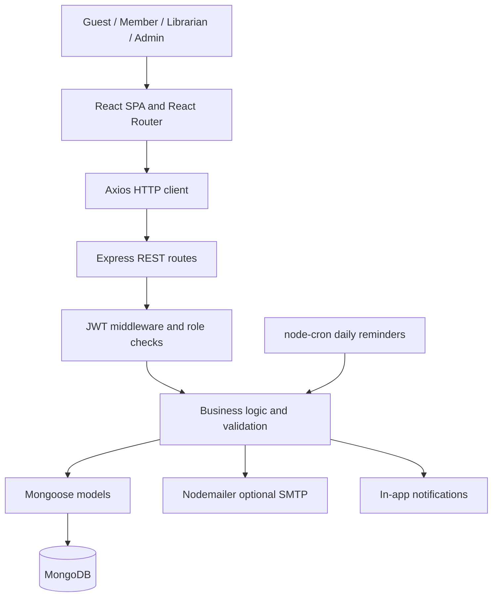
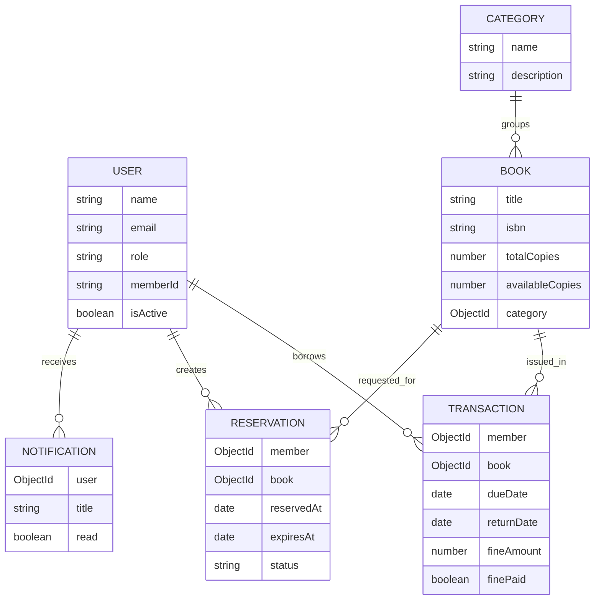

# System architecture and database design

## MERN request flow

## Main collections and relationships

## Book issue lifecycle

1. Only an authenticated librarian/admin can issue a book.
2. Check the member exists, has role `member`, and is active.
3. Read `settings` (borrow limit, unpaid fine ceiling, loan days).
4. Reject if member reached limit, owes too much, or already has this title.
5. Respect reservation holds assigned to waiting members.
6. Atomically decrement `books.availableCopies` when it is greater than zero.
7. Create a transaction, due 14 days later by default (or current settings).
8. Notify member. If a database write fails after decrement, attempt compensating increment.

## Return lifecycle

1. Librarian selects a current loan and marks it returned.
2. Calculate `fine = max(0, ceil((returnDate - dueDate) / 1 day)) × finePerDay`.
3. Atomically change the transaction to returned (only if not already returned).
4. Increment available copies and notify the member.
5. Offer the next eligible reservation a two-day pickup window.
6. Librarian records any fine payment separately.

**Concurrency caveat:** This demonstration uses atomic *single-document* operations and best-effort compensation, not a fully transactional multi-document workflow. For strong consistency, use replica-set MongoDB transactions and appropriate uniqueness/idempotency constraints.

## Why MongoDB instead of SQL?

MongoDB stores book/user records as BSON documents, and Mongoose defines schema validation. ObjectId references express relationships. A relational schema could also solve this problem, but MERN makes JavaScript the primary language end-to-end, matching the assigned stack.

## Main API endpoints

| Method | Endpoint | Purpose |
|---|---|---|
| POST | `/api/auth/register` | Register member |
| POST | `/api/auth/login` | Return JWT and safe user profile |
| GET | `/api/auth/me` | Current user |
| PUT | `/api/users/profile` | Update own profile and password |
| GET / POST | `/api/users` | List/create member or librarian (staff) |
| PUT / DELETE | `/api/users/:id/status`, `/api/users/:id` | Account management (admin) |
| GET / POST | `/api/categories` | List/add categories |
| DELETE | `/api/categories/:id` | Delete unused category |
| GET / POST | `/api/books` | Search/add books |
| GET / PUT / DELETE | `/api/books/:id` | Book details, update, delete |
| GET / POST | `/api/transactions`, `/api/transactions/issue` | List and issue (staff) |
| GET | `/api/transactions/my` | Member borrowing history |
| PUT | `/api/transactions/:id/return` | Book return + fine |
| PUT | `/api/transactions/:id/renew` | Renewal |
| PUT | `/api/transactions/:id/pay-fine` | Record fine as paid |
| GET / POST | `/api/reservations`, `/api/reservations/my` | Queues and reservations |
| DELETE | `/api/reservations/:id` | Cancel active reservation |
| GET / PUT | `/api/settings` | Library policy (admin) |
| GET / PUT | `/api/notifications`, `/api/notifications/:id/read` | In-app alerts |
| GET | `/api/reports/dashboard` | Dashboard KPIs |
| GET | `/api/reports/:type?format=csv` | Report data and export (`csv`, `pdf`, `json`) |

> Successful responses are JSON except CSV/PDF exports. Errors use `{ "message": "..." }` and suitable HTTP statuses (400/401/403/404/409/500).
